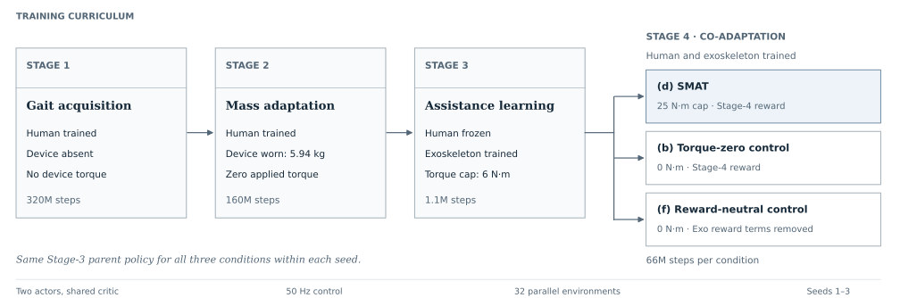

<div align="center">

<h1>SMAT Replication</h1>

<p><strong>Staged Multi-Agent Training for Co-Adaptive Exoskeleton Control</strong><br>
Code and notes for reproducing SMAT on MyoAssist</p>

<p>
<a href="https://arxiv.org/abs/2603.07618v1">SMAT paper</a> &nbsp;·&nbsp;
<a href="https://arxiv.org/abs/2608.00715v1">Extended paper and supplement</a> &nbsp;·&nbsp;
<a href="https://github.com/Fitz-Yuan/SMAT-Exo">Authors' repository</a> &nbsp;·&nbsp;
<a href="docs/IMPLEMENTATION_NOTES.md">Implementation notes</a>
</p>

</div>

This project tries to reproduce the four-stage training method from the SMAT papers [1, 2] using MyoAssist [3]. The aim is to reproduce the reported reduction in hip-muscle activation and check how the device torque and reward changes each affect the result.

The code is an independent implementation based on the papers. It follows Algorithm S1 and Tables S2–S4 from the extended paper's supplement, using version `2608.00715v1`. Details that are missing from the papers, and the choices made here, are described in the [implementation notes](docs/IMPLEMENTATION_NOTES.md).

**Status (27 October 2026):** Full training results are pending. The last recorded update was Stage-1 training for three seeds with termination variant T06. This repository contains the code and run configurations, without trained checkpoints or final evaluation results.

<p align="center">

</p>

<p align="center"><em>Training stages and the three Stage-4 runs. Each seed uses the same Stage-3 policy for runs (d), (b), and (f).</em></p>

## Training method

SMAT first trains a simulated human to walk, then adds the exoskeleton. The human model has 26 muscles. One policy controls the muscles and another controls the two hip motors, with a shared critic during PPO training [4] in MuJoCo [5].

| Stage | Training | Device | Torque limit | Steps |
|:---:|---|---|---:|---:|
| 1 | Human learns to walk | No device | 0 | 320M |
| 2 | Human adapts to the added mass | Worn, 5.94 kg | 0 | 160M |
| 3 | Exoskeleton learns, human policy frozen | Worn | 6 N·m | 1.1M |
| 4 | Human and exoskeleton learn together | Worn | 25 N·m | 66M |

In Stage 3, the human policy still samples actions, but its weights are fixed. Stage 4 gives the human policy two extra inputs: the exoskeleton commands for that step. Stage 2 updates only the human policy and critic.

Training uses 32 parallel environments. Control runs at 50 Hz, with physics at 1,200 Hz. The PPO settings follow Table S4, with a value-loss coefficient of 0.5 because the papers do not specify one. The full list is in the [PPO notes](docs/IMPLEMENTATION_NOTES.md#9-ppo) and [`stage_config.py`](smat_r3/smat3/stage_config.py). The SMAT reward formulas are in [`reward_terms.py`](smat_r3/smat3/reward_terms.py).

## Extra control runs

The original study reports a 10.1% reduction in average activation across four right-side hip muscles, comparing Stage 4 with Stage 2 [1, 2]. That result has not yet been reproduced here.

Between these stages, both the torque and the reward weights change. For example, the muscle-activation penalty rises from 0.01 to 0.15. This makes it difficult to tell how much of the reduction comes from assistance and how much comes from the reward change. Two extra Stage-4 runs are included to check this.

| Run | Device torque | Reward |
|---|---|---|
| (d) SMAT | Up to 25 N·m | Full Stage-4 reward |
| (b) Zero torque | Zero, with the device still worn and commanded | Full Stage-4 reward, including rewards based on the unused motor commands |
| (f) Zero torque without exoskeleton rewards | Zero, with the device still worn and commanded | Stage-4 reward with `r_exo` and `r_Δτ` removed |

All three runs start from the same Stage-3 policy for each seed. The hip-activation reward stays in both control runs.

Activation is measured for the right iliopsoas, gluteus maximus, rectus femoris, and hamstrings. For each seed, the percentage reduction is calculated separately for each muscle, then averaged across the four muscles. Each muscle's mean activation uses all evaluated steps, so longer episodes contribute more.

The planned main comparison is (d) against (f). Comparing (b) with (f) checks the effect of the exoskeleton reward terms. If its 95% confidence interval stays within ±2 percentage points, (d) against (f) is used to estimate the device effect. Otherwise, the comparison is (d) against (b). Run (d) is also evaluated with assistance switched off.

## Setup

The scripts target Linux and were developed on Ubuntu. Training uses the CPU. Git, curl, and several GB of free disk space are needed. The launcher also uses `nproc` and `taskset`.

```bash
git clone https://github.com/mushfique-dgist/smat-replication.git
cd smat-replication
bash deploy/setup_smat3.sh
```

The setup script installs uv if needed, downloads MyoAssist, and creates the `venv-smat3` environment. MyoAssist is fixed at commit [`3b945c7`](https://github.com/neumovelab/myoassist/tree/3b945c7bb77a1792141652681441796a6a37a4a9), from 5 February 2026, before the first SMAT preprint.

| Package | Version |
|---|---|
| Python | 3.12 |
| PyTorch | 2.14.1+cpu |
| Stable-Baselines3 | 2.7.1 |
| MuJoCo | 3.3.3 |
| Gymnasium | 0.29.1 |
| NumPy | 2.2.6 |
| pytest | 9.1.1 |

Setup checks the five main package versions and runs the tests. [`smat_r3/pip_freeze.txt`](smat_r3/pip_freeze.txt) lists the packages from the reference environment. A new installation saves its own list to `smat_r3/pip_freeze_local.txt`. Some dependencies are unpinned, so that list can differ.

## Running the training

Run the stages in order from the repository root. Each command launches all configurations for that stage. The next stage needs the previous stage's completed policy for the same seed.

```bash
bash deploy/launch_stage.sh 1     # Stage 1, seeds 1-3, T06 (deploy/configs_stage1_T06)
bash deploy/launch_stage.sh 2     # Stage 2 from each seed's Stage-1 policy
bash deploy/launch_stage.sh 3     # Stage 3
bash deploy/launch_stage.sh 4     # Stage 4: conditions (d), (b) and (f) for seeds 1-3
```

Each run is saved under `runs/<RUN_NAME>/`. The launcher splits the available CPU cores between runs. If training stops, running the command again resumes from the latest checkpoint toward the original step target.

A single run can also be started directly from the repository root:

```bash
cd smat_r3/smat3
../../venv-smat3/bin/python train.py --stage 1 --run-dir ../../runs/stage1_T06_seed1 --seed 1 --termination-variant T06
```

The next stage loads `final_policy_state_dict.pt`, which is saved only after training reaches the target step count. Evaluation uses the PPO files under `checkpoints/`.

The alternative Stage-1 T02 configurations are in `deploy/configs_stage1_T02/`. Later-stage configurations use `STAGE1_VARIANT` to select that variant's parent policy.

## Evaluation

[`evaluate_gait_gate.py`](smat_r3/eval/evaluate_gait_gate.py) runs one checkpoint through 10 episodes by default, with seeds 0–9 and deterministic policy actions. It saves muscle activation, walking speed, joint movement, and reasons for episode endings as JSON.

Start each command block below from the repository root. Replace `N` with the checkpoint's step count.

```bash
cd smat_r3/eval
../../venv-smat3/bin/python evaluate_gait_gate.py --checkpoint ../../runs/stage4d_seed1/checkpoints/ckpt_N.zip \
    --stage 4 --episodes 10 --seed 0 --out ../../runs/stage4d_seed1/eval.json
../../venv-smat3/bin/python evaluate_gait_gate.py --checkpoint ../../runs/stage4d_seed1/checkpoints/ckpt_N.zip \
    --stage 4 --device-off --out ../../runs/stage4d_seed1/eval_device_off.json
```

Use `--device-off` for both control runs. The evaluator does not read their torque setting from the training configuration.

```bash
cd smat_r3/eval
../../venv-smat3/bin/python evaluate_gait_gate.py --checkpoint ../../runs/stage4b_seed1/checkpoints/ckpt_N.zip \
    --stage 4 --device-off --out ../../runs/stage4b_seed1/eval.json
../../venv-smat3/bin/python evaluate_gait_gate.py --checkpoint ../../runs/stage4f_seed1/checkpoints/ckpt_N.zip \
    --stage 4 --device-off --out ../../runs/stage4f_seed1/eval.json
```

The planned gait checks are:

| Check | Requirement |
|:---:|---|
| G1 | Average hip-flexion range ≥ 30° on each leg |
| G2 | Average knee range ≥ 40° on each leg |
| G3 | Each hip at its joint limit in < 5% of steps |
| G4 | Average episode length ≥ 500 of 1,000 steps, with at most 5 of 10 episodes ending from reference deviation in their first 100 steps |
| G5 | Average forward speed within 15% of the target |
| G6 | Left–right symmetry index < 20% for hip and knee range |

All six checks apply at the end of Stages 1, 2, and 4. Stage 3 uses G1, G2, and G4. G1–G3 are also checked at the first Stage-1 checkpoint at or after 20M steps to catch poor gait early.

Joint ranges are measured over each episode. Hip-limit contact is measured from MuJoCo's joint-limit forces, with a position-based check as a fallback. The [evaluation notes](docs/IMPLEMENTATION_NOTES.md#12-evaluation) give the exact definitions. Comparisons between runs and confidence intervals are calculated from the saved JSON files.

## Implementation choices

Some details, including device geometry and episode termination, are not given in the papers. The main choices here are:

- End an episode when a tracked joint differs from the reference by more than 0.6 rad (T06), the pelvis drops below 0.7 m, the reference ends, or 1,000 steps pass. T02 uses a stricter 0.2 rad limit.
- Model the 5.94 kg device as a 2.5 kg pelvis unit and two 1.72 kg hip units. Their shapes and positions are assumed.
- Use 65 human-policy inputs, with two motor commands added in Stage 4. The exoskeleton gets an 18-value history of hip angles, velocities, and its own commands.
- Fix the target speed at about 1.28 m/s from the reference motion. The papers use 1.25 m/s. This also avoids an argument-order bug in MyoAssist's speed randomizer.

The reference motion has problems too. About 21.7% of right-hip samples and 17.5% of left-hip samples extend beyond the model's joint limits, so the reference values are clamped to those limits. Applying the reference pose also puts the foot below the floor in 85.2% of frames. No height correction is applied.

The [implementation notes](docs/IMPLEMENTATION_NOTES.md) keep the full measurements, observation layout, and policy-transfer details. They also explain the reward behavior inherited from this MyoAssist version. Later upstream changes to the activation and device-effort penalties are not used.

## Tests

There are 63 test cases for the reward formulas, stage settings, policy changes, and environment behavior. The model tests also check the 5.94 kg mass difference between Stage 1 and the later stages.

Run these from the repository root after setup:

```bash
venv-smat3/bin/python -m pytest smat_r3/tests -v
bash deploy/run_smoke_matrix.sh
```

The smoke script runs short versions of the training stages and both controls. It checks that each run finishes, saves a final policy, and has no NaN entries in its progress log. It clears `smat_r3/smoke_runs/` before starting and writes a summary there.

Earlier checks recorded 63 passing tests and successful smoke runs. Those logs are not included. A smaller set of 28 tests was also checked on Windows before the first upload, without rerunning the full Linux suite.

## Files

```text
deploy/                       Setup, launch scripts, and run configurations
smat_r3/
  smat3/                      Training code, policies, rewards, and environments
  eval/                       Evaluation and reference-motion checks
  models/                     XML models and scripts that generate them
  tests/                      Test cases
  requirements_r3.txt         Dependencies
  pip_freeze.txt              Reference environment
docs/
  IMPLEMENTATION_NOTES.md      Detailed choices and earlier measurements
  THIRD_PARTY_NOTICES.md       Model credits and license information
  figures/                    Training diagram
licenses/                     Third-party license text
```

## References

1. Y. Yuan, G. Androwis, and X. Zhou. **SMAT: Staged Multi-Agent Training for Co-Adaptive Exoskeleton Control.** IEEE/RSJ International Conference on Intelligent Robots and Systems (IROS), 2026, to appear. [arXiv:2603.07618v1](https://arxiv.org/abs/2603.07618v1).
2. Y. Yuan, J. Wolf, G. Androwis, and X. Zhou. **Staged Multi-Agent Training (SMAT) for Hip Exoskeletons: Metabolic and Biomechanical Validation of a Simulation-Trained Co-Adaptive Controller.** 2026. [arXiv:2608.00715v1](https://arxiv.org/abs/2608.00715v1), including supplementary material.
3. C. Robbins, H. Son, C. K. Tan, C. Wang, R. van Kanten, M. Sartori, G. Durandau, V. Kumar, V. Caggiano, and S. Song. **MyoAssist 1.0: An Open-Source Framework for Neuromechanical Simulation of Physical Human-Device Interaction.** bioRxiv, 2026. [doi:10.64898/2026.08.25.746839](https://doi.org/10.64898/2026.08.25.746839). [Code](https://github.com/neumovelab/myoassist).
4. A. Raffin, A. Hill, A. Gleave, A. Kanervisto, M. Ernestus, and N. Dormann. **Stable-Baselines3: Reliable Reinforcement Learning Implementations.** Journal of Machine Learning Research, 22(268), 1–8, 2021. [Article](https://jmlr.org/papers/v22/20-1364.html).
5. E. Todorov, T. Erez, and Y. Tassa. **MuJoCo: A Physics Engine for Model-Based Control.** IEEE/RSJ International Conference on Intelligent Robots and Systems (IROS), 2012. [doi:10.1109/IROS.2012.6386109](https://doi.org/10.1109/IROS.2012.6386109).

## Third-party code and models

MyoAssist is downloaded during setup. Its package, meshes, and reference-motion data are not included here. The two XML models are based on MyoAssist's `myoLeg26_BASELINE.xml` and keep the original credits, modification notes, and CC BY 3.0 notice.

The upstream Apache 2.0 license is in [`licenses/`](licenses/MyoAssist-Apache-2.0.txt). Further details are in [the third-party notices](docs/THIRD_PARTY_NOTICES.md).
